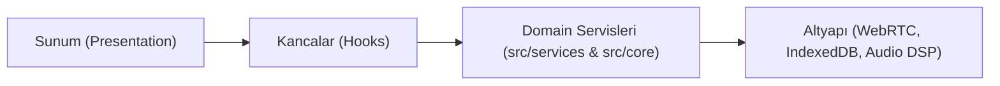

<div align="center">

# 🎮 MEVA HUD (GhostLink)
### Ultra-Lightweight Tactical Esports P2P Voice & Command Platform

[](https://nextjs.org/)
[](https://www.typescriptlang.org/)
[](https://webrtc.org/)
[](./ghostlink/docs/CLEAN_CODE_STANDARDS.md)
[](./ghostlink/Dockerfile)

**Discord ve TeamSpeak'e sıfır donanım yüküyle rakip, e-spor takımları ve rekabetçi oyuncular için özel tasarlanmış yeni nesil taktik iletişim kokpiti.**

[🚀 Proje Kodlarını İncele (ghostlink/)](./ghostlink) · [📖 Temiz Mimari Kılavuzu](./ghostlink/docs/CLEAN_CODE_STANDARDS.md) · [🐳 Dockerfile](./ghostlink/Dockerfile)

</div>

---

## ⚡ Neden Meva HUD?

Oyun esnasında arka planda çalışan klasik ses programları (Discord vb.) yüksek CPU, RAM ve GPU tüketerek rekabetçi FPS düşüşlerine (stuttering) yol açar. **Meva HUD**, doğrudan WebRTC P2P Mesh ve ultra verimli DOM mimarisiyle cihazınızı asla yormaz:

* **🎯 Sıfır FPS Kaybı (GameBoost Mode):** Oyun tam ekrandayken görünmezlik yöneticisi (Visibility Manager) rAF döngülerini askıya alır; 1000ms disk birleştirme (write-coalescing) ile disk yıpranması sıfırdır.
* **🎙️ 48kHz Stüdyo Kalitesinde Telsiz (DSP & VAD):** 8ms Push-To-Talk gecikmesi, donanım gürültü kapısı (Noise Gate), mekanik klavye tıklama filtresi ve IGL Ducking (taktik lideri konuşurken arkadaki sesleri kısma).
* **🗺️ Pro Stratbook Studio (60 FPS Taktik Masası):** CS2, Valorant, LoL, Dota 2 ve PUBG dahil 18 rekabetçi espor haritasında canlı taktik çizimi, rota planlama ve çoklu dokunmatik zoom/pan.
* **🛡️ Askeri Düzeyde Güvenlik (E2EE):** P-256 anahtar el sıkışması ve AES-256-GCM ile uçtan uca şifreli ses ve mesajlaşma; verileriniz sunucularda asla saklanmaz.
* **📱 Tam Mobil Uyum & APK Desteği:** Tek elle kullanıma uygun ergonomik alt HUD (`MobileBottomNav`), çentik güvenli alanları ve Capacitor Android desteği.

---

## 🏛️ Mimari & Clean Code Standartları

Proje, spagetti kodlardan tamamen arındırılmış ve bağımsız katmanlara bölünmüş **Clean Architecture** prensipleriyle geliştirilmiştir:



* **Tek Sorumluluk Prensibi (SRP):** Sunucu mimarisi (`ServerArchitectService`), koordinat dönüşümleri (`TacticalCoordinatesService`) ve e-spor analitiği (`ProAnalyticsService`) UI katmanından tamamen izoledir.
* **Otomasyon Doğrulaması:** `npm run build` ile 8/8 rota statik derlenir; `node scripts/verify-clean-code.mjs` ile tip ve lint hataları sıfır toleransla denetlenir.

---

## 🚀 Hızlı Başlangıç (Quick Start)

### 1. Yerel Geliştirme (Local Dev)
```bash
# Proje dizinine geçin
cd ghostlink

# Bağımlılıkları yükleyin
npm install

# Geliştirme sunucusunu başlatın
npm run dev
# Tarayıcınızda açın: http://localhost:3000
```

### 2. Docker ile Tek Komutta Çalıştırma
```bash
cd ghostlink
docker build -t meva-hud .
docker run -p 3000:3000 meva-hud
```

---

## 📊 Açık Çekirdek (Open-Core) Modeli

| Katman | Model | Kapsam |
| :--- | :--- | :--- |
| **Topluluk Sürümü** | **%100 Ücretsiz & Açık Kaynak** | Sınırsız P2P ses, taktik harita tahtası, radyal komut çarkı, E2EE şifreleme. |
| **Meva Pro Espor** | **Turnuva & Klan Lisansı** | Maç sonu akustik koçluk skoru, konuşma dengesi analitiği, taşınabilir `.strat.json` playbook dışa aktarımı. |

---

<div align="center">
Geliştirici: <strong>@Akkoq0</strong> · Meva Tactical Esports Ecosystem
</div>
