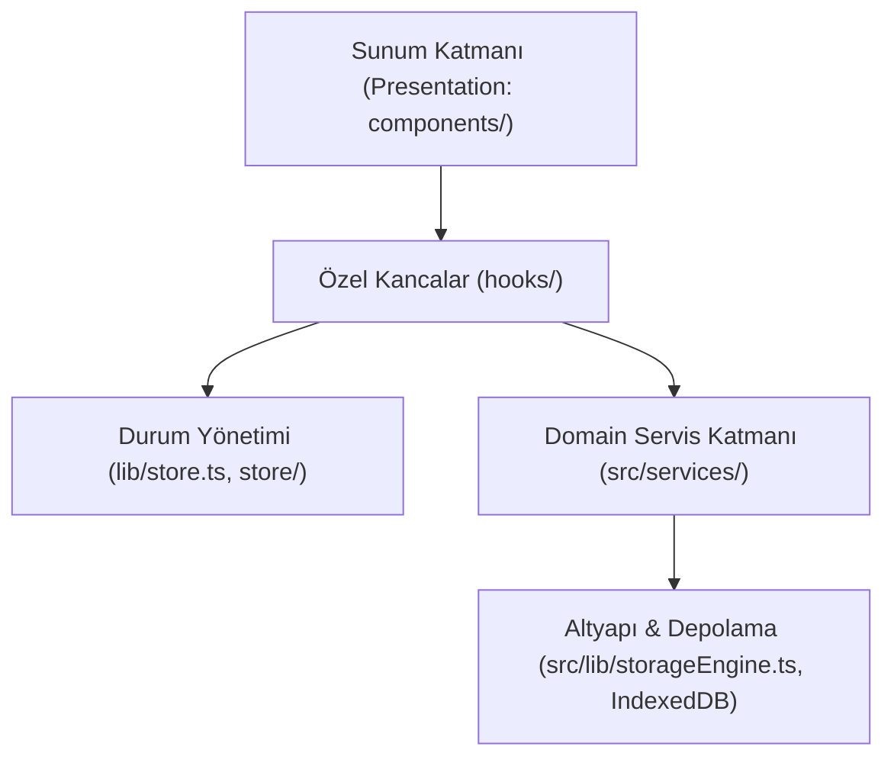

# Meva GhostLink — Clean Code & Mimari Standartları Kılavuzu

Bu doküman, Meva GhostLink projesinde uygulanan Clean Code prensiplerini, mimari katmanları, SOLID prensiplerinin Next.js/React ekosistemine uyarlanmasını ve kod kalitesi standartlarını detaylandırmaktadır.

---

## 🏛️ 1. Mimari Katman Ayrımı (Clean Architecture)

Proje katmanları birbirinden bağımsız ve tek yönlü bağımlılık kuralına göre yapılandırılmıştır:



### 1.1 Katman Kuralları:
1. **Domain Servis Katmanı (`src/services/`):**
   - Tamamen saf (pure) JavaScript/TypeScript fonksiyonları ve sınıflarından oluşur.
   - Doğrudan `react`, `window` veya `document` bağımlılığı barındırmaz.
   - Birim testleri headless ortamda anında çalıştırılabilir (`verify-clean-code.mjs`).
2. **Kanca Katmanı (`hooks/`):**
   - React yaşam döngüsünü, modal durumlarını ve kullanıcı aksiyonlarını yönetir.
   - Tek Sorumluluk Prensibi (SRP) gereği arayüz çizimi (JSX) içermez.
3. **Sunum Katmanı (`components/`):**
   - Yalnızca veriyi ve kullanıcı arayüzünü deklaratif biçimde render eder.
   - Karmaşık hesaplama, şablon türetme veya veritabanı sorguları yapmaz; bunları kancalara ve servislere delege eder.

---

## 📐 2. Uygulanan SOLID Prensipleri

### S — Single Responsibility Principle (Tek Sorumluluk Prensibi)
- **Örnek:** [HubArchitectModal.tsx](file:///workspaces/Akkoq0/ghostlink/components/modal/HubArchitectModal.tsx) içerisindeki 640 satırlık karmaşık şablon oluşturma, rol atama ve IndexedDB senkronizasyon mantığı [serverArchitectService.ts](file:///workspaces/Akkoq0/ghostlink/src/services/serverArchitectService.ts) ve [useHubArchitect.ts](file:///workspaces/Akkoq0/ghostlink/hooks/useHubArchitect.ts) bileşenlerine ayrıştırıldı.
- Arayüz bileşeni `ServerTemplatesView`, `QuickChannelPillsView` ve `CustomChannelFormView` alt parçalarına bölünerek okunabilirlik maksimize edildi.

### O — Open/Closed Principle (Açık/Kapalı Prensibi)
- Yeni espor oyunları veya harita havuzları eklenirken mevcut çizim ve koordinat hesaplama fonksiyonları değiştirilmez; [gameRegistry.ts](file:///workspaces/Akkoq0/ghostlink/src/lib/gameRegistry.ts) ve `MAP_BLUEPRINTS` genişletilerek yeni modüller doğrudan sisteme entegre olur.

### L — Liskov Substitution Principle (Liskov Yerine Geçme)
- Tüm kanal tipleri (`voice`, `text`) ve oyun kategorileri (`fps`, `moba`, `br`, `chill`) ortak `Channel` ve `GameDef` arayüzlerini eksiksiz uygular. Herhangi bir kanal tipi diğeri yerine hatasız geçebilir.

### I — Interface Segregation Principle (Arayüz Ayrımı)
- Bileşenlere devasa tekil objeler geçmek yerine, yalnızca ihtiyaç duydukları alanları içeren dar arayüzler tanımlanmıştır (ör. `CustomChannelOptions`, `Point2D`, `ViewportTransform`).

### D — Dependency Inversion Principle (Bağımlılıkların Tersine Çevrilmesi)
- Üst seviye koordinat ve taktik fonksiyonları belirli bir DOM elemanına bağımlı olmak yerine [TacticalCoordinatesService](file:///workspaces/Akkoq0/ghostlink/src/services/tacticalCoordinatesService.ts) üzerinden soyutlanmıştır.

---

## 🛡️ 3. Clean Code Kodlama Kuralları

1. **Guard Clauses (Erken Dönüş & Doğrulama):**
   - İç içe geçen `if/else` blokları yerine, fonksiyonun başında geçersiz koşullar kontrol edilip erken çıkış yapılır:
   ```ts
   if (!isOpen) return null;
   ```
2. **Result Monadı ve Güvenli Hata Yönetimi:**
   - Boş `catch {}` blokları yerine [cleanCodeUtils.ts](file:///workspaces/Akkoq0/ghostlink/src/services/cleanCodeUtils.ts) üzerindeki `Result<T, E>`, `success`, `failure` ve `safeJsonParse` modelleri kullanılır.
3. **Sıfır `any` Tipi & Sıkı Tip Güvenliği:**
   - Tüm veri modelleri TypeScript sıkı modunda derlenir (`npx tsc --noEmit` hatasız).
4. **DRY (Don't Repeat Yourself):**
   - ID üretimi, kategori eşleme ve rol filtreleme mantıkları tekilleştirildi (`generatePrefixedId`).

---

## 🧪 4. Otomasyon & Doğrulama

Temiz kod ve mimari kuralları aşağıdaki komutla test edilir:
```bash
node scripts/verify-clean-code.mjs
```
Komut; TypeScript tip kontrolünü, ESLint standartlarını, servis katmanı saflığını ve birim testleri sıfır hata ile doğrular.
